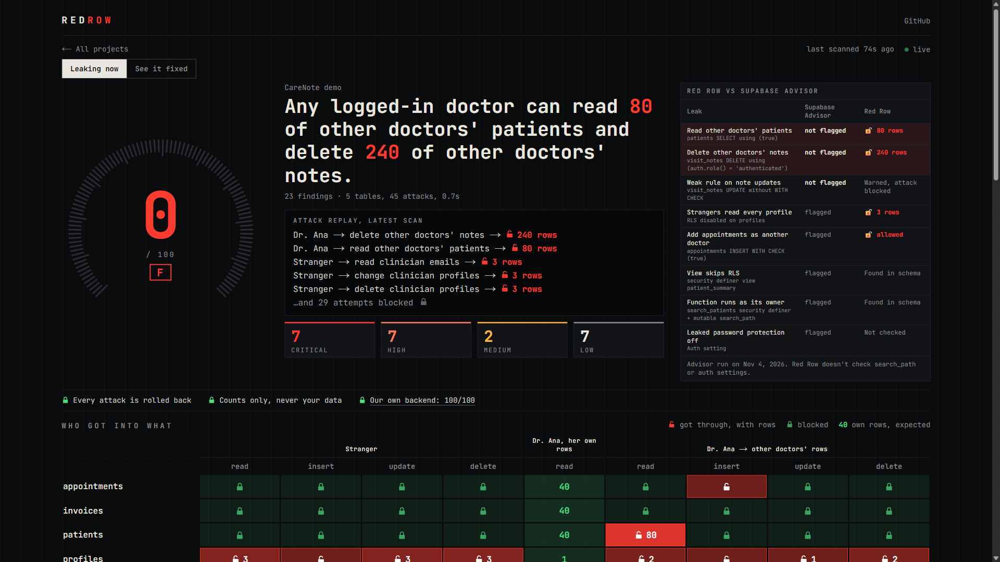
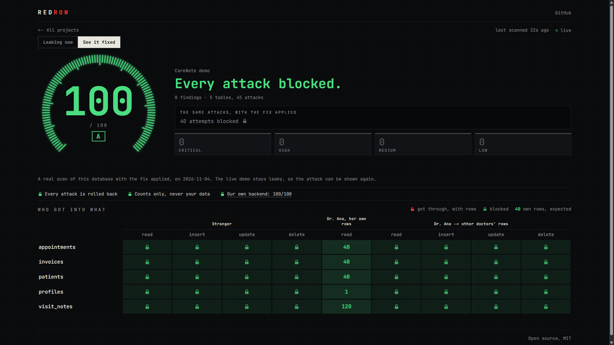

# Red Row

**AI wrote your RLS. Red Row proves whether it leaks.**

**[See it live → redrow.vercel.app](https://redrow.vercel.app)**

Supabase's Security Advisor reads your configuration. Red Row checks whether Row Level Security *works*: it attacks your database as real users, and reports what got through, with row counts.

| Leaking now | See it fixed |
|---|---|
|  |  |

## For judges

Each claim links to the file that backs it. Measurements are from Nov 4, 2026.

### Data quality

- **Watched by Sodabase:** `scan_runs`, `findings` and `probe_results` on `redrow-hq`, each with freshness and new-row monitors, plus the rules below.
- **Sodabase verdicts** (`check_trust`, Nov 4, 20:56 UTC): `scan_runs` trusted, `findings` trusted, `probe_results` unknown, because its freshness monitor has no history yet. There are no open issues, and a fresh content scan found no serious issues. Volume, schema and null checks report unknown on all three.
- **Insert-only:** `anon` and `authenticated` get `SELECT` on the scan tables, and there are no update or delete policies ([grants](hq/supabase/migrations/0001_init.sql#L96-L101)). The one exception is that a signed-in user can add their own row to `projects`, and email signups are off.
- **Constrained:** [`0001_init.sql`](hq/supabase/migrations/0001_init.sql) has foreign keys, `NOT NULL`, and checks on scores, grades, counts, severities, rule ids, actors, actions and outcomes.
- **Continuous:** a [`pg_cron` sweep](hq/supabase/migrations/0006_sweep_retries.sql) stored 488 real scans from 13:41 to 19:20 UTC. The median gap was 60s for CareNote and 80s for HQ.
- **Labeled history:** 14 days of backfilled scans are marked `source = 'seed'` by [the seed script](hq/scripts/seed-history.mjs), and the dashboard draws them dashed.
- **New-row issues, marked expected:** Sodabase raised one issue on each table when volume rose, and we marked them expected, which cleared them and moved the verdicts from `untrusted` to those above. The rise is real: by 18:23 UTC the live sweep had taken `scan_runs` to 560 rows on Nov 4, against 192 a day in the seeded history. [`demo:capture-fixed`](demo-target/scripts/capture-fixed-reference.mjs) also pauses the sweep briefly, but around its 17:58 UTC capture no CareNote gap passed 100 seconds, so that isn't the cause.

| Table | Rule | Nov 4 result | Watched by Sodabase |
|---|---|---|---|
| `scan_runs` | `score` between 0 and 100 | pass, 0 rows break it | yes |
| `scan_runs` | `probes_run` greater than 0, on every row | pass, 0 rows break it | yes |
| `findings` | every `scan_run_id` exists in `scan_runs` | pass, 0 rows break it | yes |
| `findings` | `rows_exposed` is null or at least 0 | pass, 0 rows break it | yes |
| `scan_runs` | no two rows for one `project_id` within 30 seconds | **fail**, 8 pairs, all sweeps between 13:41 and 14:13 UTC, none since | no |

The last rule compares rows with each other, which Sodabase's `check_rule` couldn't express, so we measured it directly. It fails on those early rows, and HQ is insert-only, so they stay.

Red Row's write attacks show who could corrupt data; Sodabase detects corruption after the fact. Prevention plus detection.

### Built to scale

- **Indexes:** every foreign key and policy column is indexed ([`findings`](hq/supabase/migrations/0001_init.sql#L52-L54), [`probe_results`](hq/supabase/migrations/0001_init.sql#L68-L69)).
- **RLS:** [enabled and forced](hq/supabase/migrations/0001_init.sql#L72-L79) on all four tables, with [`(select auth.uid())`](hq/supabase/migrations/0001_init.sql#L82-L95) in every policy that checks the user.
- **Writes:** no API role can write the scan tables. The edge functions [`ingest`](hq/supabase/functions/ingest/index.ts) and [`sweep`](hq/supabase/functions/sweep/index.ts) insert each scan [in one transaction](hq/supabase/functions/_shared/store.ts), over a server-side database connection. `ingest` needs a key and [validates every report](hq/supabase/functions/_shared/report-schema.ts).
- **Scheduling:** `pg_cron` calls `sweep` through `pg_net`, with its token [read from Vault](hq/supabase/migrations/0006_sweep_retries.sql). It asks every 20 seconds because `pg_net` requests often stall, and `sweep` skips a database scanned in the last 50 seconds.
- **Realtime:** [`scan_runs` and `findings` are published](hq/supabase/migrations/0001_init.sql#L103-L104), and [the dashboard subscribes](apps/web/components/live.tsx).
- **Self-scan:** Red Row scans its own backend about every minute (median 80s). All 212 real scans from 13:41 to 19:20 UTC scored 100/A, with `projects` [declared public](hq/redrow.config.json) because it backs the public board.

### Execution

- **Live:** https://redrow.vercel.app is public, needs no login, and updates itself when a sweep lands.
- **End to end on real Supabase:** `scan` 0/F → `fix --apply -y` → 100/A. The exact steps are in [`docs/DEMO.md`](docs/DEMO.md). "See it fixed" shows [a stored real scan](apps/web/data/fixed-reference.json) of this database with [the reference fix](demo-target/supabase/fixed.sql) applied: 100/A, 45 attacks.
- **Tests:** 994 pass: engine 512, CLI 399, HQ 15, web 68. That run includes the real-database tests, which skip when `REDROW_TEST_DB_URL` isn't set.
- **Rollback safety:** [`rollback.test.ts`](packages/engine/test/rollback.test.ts) makes a probe really write, then checks that nothing persisted, including after a probe throws or the server rejects a statement. It also checks that a full scan changes nothing and that read-only mode sends no write.

### Craft

**The problem:** in [an audit of 200 vibe-coded apps](https://arxiv.org/abs/2606.23130), 91% had at least one vulnerability, and 65.77% of the vulnerabilities were Critical or High, concentrated in broken access control, injection and authentication failures. [More below](#why-this-exists).

**Supabase's Advisor reads policy text. Red Row logs in and tries.**

| Leak on the CareNote demo | Supabase Advisor | Red Row |
|---|---|---|
| Read other doctors' patients: `patients` SELECT `using (true)` | not flagged | 🔓 80 rows |
| Delete other doctors' notes: `visit_notes` DELETE `using (auth.role() = 'authenticated')` | not flagged | 🔓 240 rows |
| Weak rule on note updates: `visit_notes` UPDATE without `WITH CHECK` | not flagged | Warned, attack blocked |
| Strangers read every profile: RLS disabled on `profiles` | flagged | 🔓 3 rows |
| Add appointments as another doctor: `appointments` INSERT `WITH CHECK (true)` | flagged | 🔓 allowed |
| View skips RLS: security definer view `patient_summary` | flagged | Found in schema |
| Function runs as its owner: `search_patients` security definer + mutable `search_path` | flagged | Found in schema |
| Leaked password protection off | flagged | Not checked |

Advisor run on Nov 4, 2026. Red Row doesn't check `search_path` or auth settings, so use both tools.

**Why this needs an attack, not a read:**

- [Supabase's RLS docs](https://supabase.com/docs/guides/database/postgres/row-level-security): "Until the suite passes, you don't know whether the policies do what you intended." Red Row runs the attack side of that check without you writing the tests.
- [Sodabase's docs](https://sodabase.io/docs/database-access): its monitoring role "is created `bypassrls`, so on those tables it reads every row." So it can't see access leaks. Sodabase checks that the data is healthy, Red Row checks who can reach it, and the two are complementary.

## Quickstart

Needs Node 20+. Use the **Session pooler** connection string from Supabase → Connect (port 5432).

```bash
git clone https://github.com/koushikvasa/redrow && cd redrow
npm install
npm run scan -- --db "<session pooler url>" -y
```

`-y` confirms you mean this database. Red Row refuses a remote database otherwise, unless it's listed in `allowHosts` in `redrow.config.json` or its name contains test, demo or staging. No API key needed.

Red Row isn't on npm, so run it from a clone.

## How it works

1. **Signs in** as a stranger and as real users.
2. **Tries to read and change** other people's rows.
3. **Rolls everything back**, scores it 0–100, and writes the fix.

## Safety

- **Always rolled back.** Every attack runs in its own transaction that ends in `ROLLBACK`, with a 5s statement timeout and a 1s lock timeout.
- **Counts only.** It records row counts, owner ids and catalog metadata. It never reads or prints your row contents.
- **Your data stays home.** Claude only sees schema text, policy text and finding metadata, and only if you set an API key.
- **Opt out of writes.** `--read-only` skips every write attempt.
- **Asks before production.** Remote databases need `-y` or an `allowHosts` entry, unless the database name contains test, demo or staging. Use a staging project or a branch where you can.

> **What a rollback can't undo:** sequence values, and outside effects from triggers and extensions such as `dblink` or `http`. If a trigger on your table calls out to another system, use `--read-only`.

## What it checks

**Read from your schema**

| Rule | Severity | Problem |
|---|---|---|
| RR001 | Critical | RLS disabled, and the table is publicly readable through the API |
| RR002 | High | RLS disabled on a table API roles can access |
| RR003 | High | Read policy matches every row (`USING true`) |
| RR004 | Medium | UPDATE policy has no explicit `WITH CHECK` |
| RR005 | Medium | INSERT policy doesn't check row ownership |
| RR006 | High | View bypasses RLS |
| RR007 | High | `SECURITY DEFINER` function callable from the API |
| RR008 | Low | Policy re-evaluates `auth.uid()` for every row |
| RR009 | Low | Owner column used in a policy has no index |
| RR010 | Medium | RLS enabled with no policies, so API roles see nothing |

**Proven by attacking**

| Rule | Severity | Who did what |
|---|---|---|
| RR101 | Critical | Anonymous users read an owned or sensitive table |
| RR102 | Critical | A signed-in user read other users' rows |
| RR103 | Critical | A signed-in user updated other users' rows |
| RR104 | Critical | A signed-in user deleted other users' rows |
| RR105 | High | A signed-in user inserted a row owned by someone else |
| RR106 | High | Anonymous users wrote to a table |

## Reports and fixes

```bash
npm run scan -- --db "<url>" -y --html report.html     # a self-contained page to share
npm run scan -- --db "<url>" -y --json > report.json   # the input for fix
npm run fix  -- --db "<url>" -y --from report.json     # writes redrow-fix-<timestamp>.sql
npm run fix  -- --db "<url>" --from report.json --apply   # asks y/N, applies, rescans
```

### How `fix` works

- **Who writes it:** Claude if `ANTHROPIC_API_KEY` is set, rule-based templates if not. The file's first line names the model that answered.
- **Parsed first:** every statement is checked against an allowlist. No `DROP TABLE`, no `GRANT`, no `COMMIT` hidden in the middle.
- **Limited in scope:** model-written SQL may only touch objects the report flagged.
- **Tried before it's written:** it runs in a transaction that's rolled back, so bad SQL never reaches the file.
- **Your call to apply:** `--apply` asks first, then rescans and prints before → after.

Read a model's migration before applying it. The checks judge what a statement is and what it touches, not whether its logic is right. [`docs/ENGINE.md`](docs/ENGINE.md) section 6 has the details.

### In CI

```bash
npm run scan -- --db "$DB_URL" -y --read-only --severity high
```

Exit codes: `0` nothing at or above `--severity`, `1` findings, `2` couldn't run or proved nothing.

## Architecture

```
                 your Supabase database
                           ▲
                           │  attacks, always rolled back
                           │
                    packages/engine
       introspect → static rules → probes → score
              ▲                        ▲
              │                        │
        packages/cli            hq sweep function
   terminal, JSON, HTML, fix    pg_cron, about every minute
              │                        │
              │ --upload               │ counts only
              ▼                        ▼
       hq ingest function ──►  HQ database (Supabase)
                               insert-only, RLS forced
                                       │  Realtime
                                       ▼
                               apps/web on Vercel
                               redrow.vercel.app
```

The engine has no Node-only APIs and no database driver of its own, so the same build runs in the CLI and in Deno edge functions. HQ scans itself on the dashboard, and scores 100.

## Why this exists

- **[CVE-2025-48757](https://nvd.nist.gov/vuln/detail/CVE-2025-48757) (CVSS 9.3):** insufficient RLS in Lovable-generated sites let unauthenticated attackers read or write database tables. The supplier disputes it, saying each customer is responsible for their own data.
- **[Moltbook](https://wiz.io/blog/exposed-moltbook-database-reveals-millions-of-api-keys):** a Supabase key in client-side JavaScript with no effective RLS exposed about 4.75M records, including 1.5M API tokens.
- **[Understanding the (In)Security of Vibe-Coded Applications](https://arxiv.org/abs/2606.23130):** 91% of 200 audited apps had at least one vulnerability. 65.77% of those vulnerabilities were Critical or High, concentrated in broken access control, injection and authentication failures.
- **[Structured Decomposition for Reliable LLM-Generated Access Control Policies](https://arxiv.org/abs/2609.24036):** a single-prompt LLM baseline got deny rules right 37.5% of the time and ownership conditions 40% of the time. The policies were Rego, not RLS, but it's the same kind of mistake.

Red Row checks behavior, not configuration: a policy like `using (true)` is "on", passes a linter, and still lets every signed-in user read every row.

<details>
<summary><strong>Running your own HQ and dashboard</strong></summary>

HQ is a Supabase project. With its values in `.env` (see `.env.example`), and `<ref>` as its project ref:

```bash
npx supabase --workdir hq db push --db-url "$HQ_DB_URL"
npm run sync:engine
npx supabase --workdir hq secrets set --project-ref <ref> DEMO_DB_URL=... HQ_POOLER_DB_URL=... SWEEP_TOKEN=... REDROW_INGEST_KEY=...
npx supabase --workdir hq functions deploy ingest sweep --project-ref <ref> --use-api
node hq/scripts/seed-history.mjs
```

- Store the sweep token in Vault: `select vault.create_secret('<token>', 'sweep_token')`.
- Turn off email signups, or anyone could add projects to the public board.
- Each sweep writes about 100 rows. To stop them: `select cron.unschedule('redrow-sweep')`.
- Scan HQ itself: `npm run scan -- --config hq/redrow.config.json --db "$HQ_DB_URL"`.
- Send any scan to HQ: set `REDROW_INGEST_URL` and `REDROW_INGEST_KEY`, and add `--upload --project "<name>"`.
- Name the attackers: `personas` sets the words, and `actors` pins user A by email, keyed by project name or by `host/login`. The dashboard reads `hq/redrow.config.json`, so run `npm run sync:web` after changing it. The terminal reads whichever config it's given, and only uses a persona when its pinned user was found.

`apps/web` is a standalone Next.js app, kept out of the root workspace so that scanning from a clone doesn't download it. It reads HQ with the anon key only, so it shows what RLS shows anyone.

```bash
cd apps/web && npm install && npm run dev   # needs NEXT_PUBLIC_SUPABASE_URL and NEXT_PUBLIC_SUPABASE_ANON_KEY in .env.local
npx vercel --prod                           # deploys from apps/web
```

</details>

## Docs

- [`docs/ENGINE.md`](docs/ENGINE.md): rules, probes and scoring
- [`docs/SCHEMAS.md`](docs/SCHEMAS.md): the HQ schema and the deliberately leaky CareNote demo
- [`docs/DEMO.md`](docs/DEMO.md): the 3-minute demo, step by step
- [`docs/PITCH.md`](docs/PITCH.md): the pitch, sources and likely questions

## License

[MIT](LICENSE)
